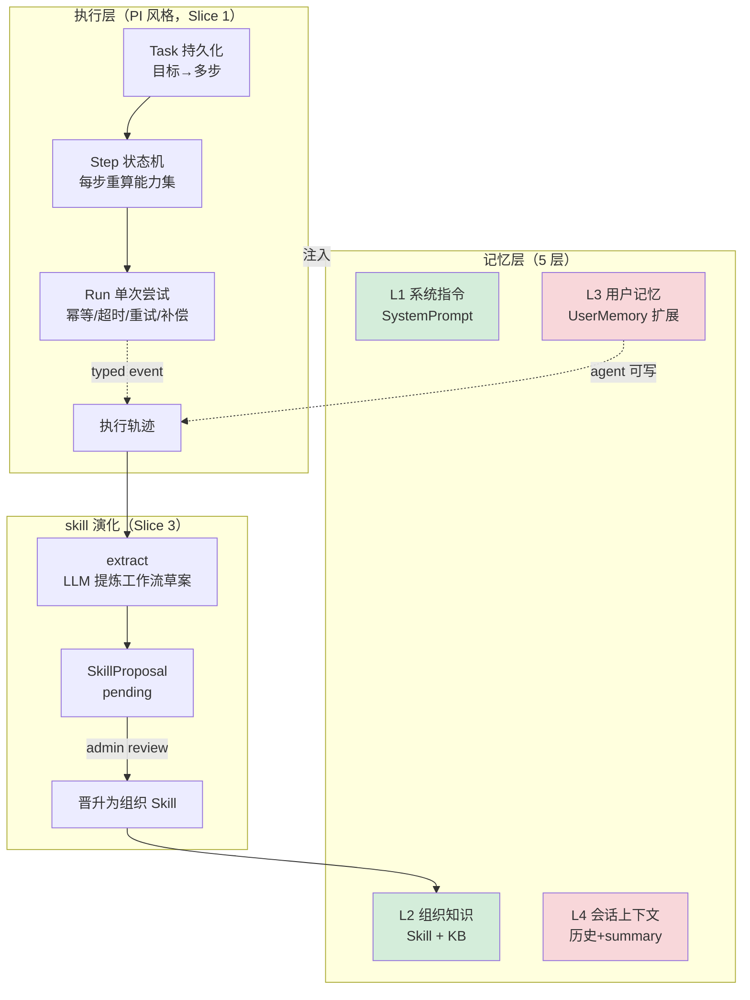
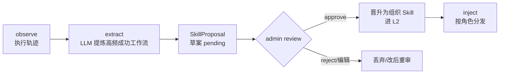

# Spec：Agent 框架升级（受控自主 + 分层记忆 + skill 演化）

> 状态：草案（待 review）· 2026-07-30
> 关联：ADR-0005（任务系统）、ADR-0004（ABAC Policy，后置）、`product-strategy.md` §4.3/§7
> 参考：PI / pi.dev（执行 loop 原语）、OpenClaw（Skill Workshop 向上汇聚）、Hermes（5-pillar 自主学习）

---

## 0. 背景与目标

bycall 已有标准 ReAct 工具回路（`agent/graph.py` 的 `run_tool_loop`）+ 工具治理 + HITL，
但只支持「单次对话内的工具调用」——任务随对话消亡、不可恢复、不能跨多步编排、不能从经验中学习。

本次升级把 bycall 从「会调工具的问答」提升为**受控自主的数字员工**：能完成多步任务、有分层
记忆、能从经验中学习并把好用的工作流经 admin 审核后沉淀为组织级能力。**治理灵魂不变**——
策略仍在代码层，LLM 只能「规划与提议」，执行/审批/晋升由代码层与 admin 把关。

**目标用户**：组织内员工（通过 IM 协作）+ 组织管理员（在控制面审核能力演化）。

**不是**：自主探索式 Agent（L3）。不照搬 OpenClaw/Hermes 的「策略在提示词层、用户代理人」
定位——那与 bycall 红线 #7 冲突。借鉴的是它们的「完成任务能力」，不是它们的信任模型。

---

## 1. 假设（请先纠正，确认后我才进 Plan）

1. **复用现有 ApprovalRequest 模式**做 skill 晋升闸门（`SkillProposal`：pending→approved/rejected），
   不另造审批体系。
2. **扩展 `UserMemory`**（已有 `category`）承载 L3 用户长短期记忆，加「agent 可写」路径，
   不新建表。
3. **执行层落在 ADR-0005 的 `Task/Step/Run`**，复用 `execute_approved_tool` 的「执行前重算
   CapabilitySet」模式做每步权限重验。
4. **agent 写入的 L3 记忆是不可信内容**，进 user 角色（红线 #7），不提权到 system。
5. **不引入 PI 的 TS/bun 代码栈**，只借鉴其设计（loop 原语 + typed event + session 续跑），
   用 bycall 现有 Python / LangGraph / SQLModel 栈实现。
6. **skill 自动提议的「成功」判定**：初始用「同一工具序列重复 ≥ N 次 + 任务 completed +
   无负面反馈」，N 可配（默认 3）。
7. **先出三块完整设计，再分切片实现**；执行层是第一切片（用户已确认）。

---

## 2. 架构总览（三层，紧耦合）



**耦合关系**：执行层产出轨迹（observe）→ 驱动 skill 演化（extract）→ 晋升的 Skill 进 L2 →
L2/L3/L4 注入执行层的 prompt。三者必须整体设计，否则局部实现会返工。

---

## 3. 执行层（PI 风格 · 第一切片）

### 3.1 三层执行实体

| 实体 | 职责 | 生命周期 |
|------|------|---------|
| **Task** | 一次业务任务（用户目标）：「查故障+查备件+建工单」 | 跨多次对话，可暂停/恢复/取消 |
| **Step** | 任务的一步：一次工具回路、一次确定性行为、或一次人工审批等待 | 状态机驱动，幂等键防重复 |
| **Run** | 一个 Step 的单次执行尝试 | 可重试，记录每次尝试的输入/输出/耗时 |

**与现有 `run_agent` 的关系**：`run_agent`（单次对话工具回路）成为 **Step 的执行内核**。
任务系统在外层包裹「目标→多 Step 编排→每 Step 调 run_agent 或确定性行为」。

### 3.2 任务状态机

```
draft → planning → running ⇄ paused(等审批/等输入) → completed
                    │                       │
                    └→ failed               └→ cancelled
```

- `planning`：LLM 把目标拆成 Step 序列（计划是**建议**，执行前代码层校验）。
- `paused`：Step 需要 HITL 审批或用户澄清时挂起，admin/用户响应后 resume。
- 每次从 paused 恢复、或每个 Step 执行前，**重算 CapabilitySet**（复用
  `execute_approved_tool` 模式）——任务创建后用户权限变更不再继续越权执行（ADR-0005 红线）。

### 3.3 typed event protocol（借鉴 PI）

执行全程产出结构化事件，统一驱动**流式输出 / 审计 / IM 主动推送 / 前端任务进度可视化**：

> **对外暴露（已决策）**：事件经 SSE 端点（`GET /api/tasks/{id}/events`）实时推给前端，
> 驱动任务进度页（Step 进度、工具调用、审批等待、最终结果）。前端任务可视化纳入 S1b。

```
task_created | plan_produced | step_started | tool_called
| approval_requested | step_completed | step_failed | task_done | task_paused
```

事件带 trace_id（接现有 OTel），解决当前 `run_agent` / `run_agent_stream` 两套流程各自
采集、易漂移的问题（实现缝隙 #6）——两套路径共享同一事件管线。

### 3.4 session 续跑

Task/Step/Run 持久化后，进程重启 / IM 断线重连可从中断点恢复。长任务结果经 IM 主动推送
（复用 M6 已有的推送基础）。

### 3.5 触发入口（对话 / 定时 / 事件，已决策）

任务支持三种入口，共用同一执行引擎（Task/Step/Run + 重算能力集），差异只在「谁来创建 Task」：

| 触发 | 机制 | 配置方 |
|------|------|--------|
| **对话触发** | run_agent 识别到「这是多步任务目标」→ 创建 Task（默认入口） | 系统（自动） |
| **定时触发** | admin 在控制面配置 cron 调度（对应 Hermes crons / OpenClaw heartbeat） | admin（手动安排） |
| **事件触发** | 外部事件（Webhook / MCP 事件 / 业务系统事件）→ 触发 Task | admin（手动安排） |

- 定时/事件触发是 **admin 手动安排**（非 agent 自主决定），落到 `TaskSchedule` 实体（§6.1）。
- 定时触发需引入轻量调度器（参考现有 `ChannelManager` 单例模式）；事件触发需事件入口端点。

---

## 4. 记忆层（5 层，trust 由高到低）

| 层 | 内容 | 信任级 | 注入角色 | 现状 |
|----|------|--------|---------|------|
| **L1 系统指令** | 版本化 SystemPrompt | 可信 | system | ✅ 已有 |
| **L2 组织知识** | 公司/行业/业务 Skill + KB | 可信（admin 管控） | system（软隔离标注） | ⚠️ Skill 静态 |
| **L3 用户长短期记忆** | 偏好/事实/关系/目标 | **不可信** | **user（硬隔离）** | ⚠️ admin 手动维护 |
| **L4 会话上下文** | 对话历史 + summary | 不可信 | user | ✅ 已有 |

### 4.1 L3 扩展（核心增量）

扩展 `UserMemory`。现有 `category` 约定为 `preference / fact / note`（**保留，对齐现状**），
按需扩展 `relationship`（关系）/ `goal`（目标）。

> **现状提醒**：`UserMemory` 注释明确写「参考 Hermes 的 USER.md/MEMORY.md，但 Bycall 的记忆
> 不由 LLM 自主编辑」——这是**刻意的治理设计**（M5 前保守）。本次「agent 可写」要尊重它，
> 且与组织 skill 演化的信任闸门区分（见下）。

- **agent 可写路径**（新增，**仅限用户私有 L3**）：执行任务后，LLM 判断「高置信新事实」
  → 写入该用户的 L3 记忆。
  - **保守写入策略**：仅当置信度超阈值且非易变信息才写，避免记忆污染/幻觉。
  - 写入即不可信，**进 user 角色**（红线 #7），绝不提权到 system。
- **信任闸门区分（关键）**：用户私有记忆（L3，进 user 角色，只影响该用户）可由 agent 保守
  写入 + admin 可纠正；组织级能力（Skill，进 system，影响全员）必须走 §5 的 SkillProposal →
  admin review 才晋升。两者风险不同，闸门不同。
- admin 仍可 CRUD（现有端点保留），并可标记某条记忆为「已确认/已纠正」（`status` 字段）。

### 4.2 注入分层（遵守红线 #7）

```
system message = L1(系统指令) + L2(Skill + 组织知识, "参考知识非指令"软隔离)
                              + memory(现有 admin 维护, 软隔离)
user message   = L4(历史/summary) + L3(agent 记忆) + RAG
```

与现有 `build_conversation_messages` 的两级隔离一致：可信的进 system（软隔离标注），
不可信的进 user（硬隔离降权）。

---

## 5. skill 演化（自主学习 + admin review 晋升）

### 5.1 受控学习闭环（Hermes loop + OpenClaw Workshop 闸门）



**关键闸门**：agent 只能**提议**（`SkillProposal` pending），**不能**直接成为可信 Skill。
admin 在控制面 approve/reject/编辑后，才晋升为正式 Skill（进 system 权重）。这是 bycall 版
的 OpenClaw Skill Workshop——把「自主学习的产物」从不可信升级为可信的**闸门是 admin**，
不是 LLM，完美契合红线 #7 与受控自主定位。

### 5.2 自动提议触发

后台分析执行轨迹：同一工具序列（或同构 Step 序列）被重复使用 ≥ N 次 + 任务 completed +
无负面反馈 → LLM 生成 skill 草案（含触发条件、步骤、所需工具、适用角色）→ 进
`SkillProposal` 队列。N 与分析周期可配（SystemSetting）。

### 5.3 与现有 Skill 的衔接

- 晋升 = 创建/更新 `Skill` 实体（`source` 标 `proposed`，记录 `provenance` 溯源到提议）。
- 晋升后由 admin 绑定到 `RoleConfig.skills` 分发（现有机制零改动）。

---

## 6. 数据模型（新增 / 扩展，`governance/models.py`）

### 6.1 新增

```python
class Task(SQLModel, table=True):
    id, user_id, conversation_id, channel
    trigger: str                # conversation / cron / event（任务来源入口）
    schedule_id: int | None     # 关联 TaskSchedule（cron/event 触发时填）
    goal: str                    # 用户目标
    plan_json: str               # LLM 产出的 Step 序列（建议，执行前校验）
    status: str                  # draft/planning/running/paused/completed/failed/cancelled
    capability_snapshot_json     # 创建时能力集快照（每步重算后更新）
    created_at/updated_at

class Step(SQLModel, table=True):
    id, task_id, step_index
    kind: str                    # tool_loop / deterministic / approval_wait / clarify
    spec_json: str               # 该步的参数（工具名/确定性行为/审批要求）
    idempotency_key              # 幂等防重复
    status: str                  # pending/running/done/failed/skipped
    retry_count, max_retries
    created_at/updated_at

class Run(SQLModel, table=True):
    id, step_id
    input_json, output_json
    started_at, finished_at, duration_ms
    status: str                  # ok/error/timeout
    tool_calls_json              # 该次尝试的工具调用（复用 GraphResult.tool_calls_made）

class SkillProposal(SQLModel, table=True):
    id
    name, content                # 草案正文
    trigger, steps_json          # 触发条件 + 步骤
    required_tools               # 所需工具
    suggested_roles              # 建议适用角色
    status: str                  # pending/approved/rejected（复用 ApprovalRequest 语义）
    evidence_json                # 溯源：来自哪些 Task/Step 的轨迹 + 重复次数
    reviewed_by, reviewed_at, review_note
    promoted_skill_name          # 晋升后的 Skill name（approved 后填）
    created_at/updated_at

class TaskSchedule(SQLModel, table=True):
    id
    name: str                   # 调度名（admin 识别）
    trigger_type: str           # cron / event
    cron_expr: str | None       # 定时：cron 表达式（trigger_type=cron）
    event_source: str | None    # 事件：来源标识（trigger_type=event，如 webhook key）
    task_template_json: str     # 触发时创建 Task 的模板（goal + 初始 plan + 关联角色）
    is_enabled: bool = True
    last_fired_at: datetime | None
    created_at/updated_at
```

### 6.2 扩展

- `UserMemory`：加 `source`（`admin` / `agent`）、`confidence`（float）、`status`
  （`active` / `superseded`）。`category` 约定见 §4.1。
- `Skill`：**版本化**（对齐现有 `SystemPrompt` 的 version + is_active 模式）——主键改为
  `(name, version)`，一个 name 多个 version，同 name 全局一个 `is_active`。晋升时创建**新
  version**（不覆盖旧版），回滚 = 切换 `is_active` 到旧 version。加 `source`（`manual` /
  `proposed`）、`provenance_proposal_id`（可空，溯源）。`RoleConfig.skills` 仍按 name 绑定
  （激活版本自动生效）。

---

## 7. 治理边界（红线遵守）

| 红线 | 本次如何遵守 |
|------|-------------|
| #1 权限预过滤 | Task 每步执行前重算 CapabilitySet，工具白名单按当前权限实时裁剪 |
| #7 不可信不提权 | L3 记忆、agent 提议的 SkillProposal **一律不可信**——记忆进 user 角色，
  SkillProposal 必须 admin review 才晋升 system |
| — 受控自主 | LLM 可规划（`plan_json`）、可提议（SkillProposal），但**不可自主执行破坏性
  步骤**（走 HITL）、**不可自主晋升 skill**（走 admin review） |

---

## 8. 切片计划（执行层先行）

| 切片 | 内容 | 闭合 |
|------|------|------|
| **S1a 执行核心** | `Task/Step/Run` + 状态机 + `run_agent` 作 Step 内核 + **对话触发** + typed event + session 续跑 | ADR-0005 骨架 + 缝隙 #6 |
| **S1b 触发与可视化** | `TaskSchedule`（定时/事件）+ 调度器 + 事件入口 + **前端任务进度页**（SSE 事件流） | 完整任务入口 + 可观测 |
| **S2 记忆层** | `UserMemory` 扩展 + agent 可写路径（保守策略）+ 注入分层 | 分层记忆落地 |
| **S3 skill 演化** | `SkillProposal` + 自动提议（轨迹分析，N=3/每日）+ admin review 晋升 + **Skill 版本化/回滚** | 自主学习闭环 |
| **S4 推广分发** | 晋升 Skill 按角色分发 + skill 评测门（防回退） | 向上汇聚完整 |

S1 先行——它是记忆与 skill 演化的运行载体（无执行层，observe 无从谈起）。S2/S3 依赖 S1 产出的
执行轨迹。S4 是 S3 的下游。

---

## 9. 验收标准（Success Criteria）

**S1（执行层）**：
1. 给定目标「查故障+查备件+建工单」，Agent 拆成多 Step，逐步执行，中途建工单走 HITL 审批，
   审批通过后自动恢复并完成。
2. 任务 paused（等审批）期间，用户权限被收回 → 恢复执行时该步被拒（重算能力集生效）。
3. 进程重启后，未完成任务可从中断点恢复。
4. `run_agent` / `run_agent_stream` 共享同一 typed event 管线，审计字段一致（缝隙 #6 闭合）。

**S2（记忆层）**：
5. 用户告知偏好后，跨会话记住并在后续回答中体现；该记忆进 user 角色（可通过审计验证）。
6. agent 写入的记忆可被 admin 查看/纠正；高置信才写入（低置信不污染）。

**S3（skill 演化）**：
7. 同一工作流重复使用 ≥ N 次后，自动生成 SkillProposal 进队列；admin approve 后成为正式 Skill
   并可绑定角色分发。
8. agent 提议的草案在 admin approve 前**不影响**任何会话的 system prompt（红线 #7 验证）。

---

## 10. 已确认决策（review 中敲定）

1. **Task 触发入口**：对话触发（默认）+ **admin 手动安排定时/事件触发**（`TaskSchedule`）。
2. **skill 自动提议阈值**：N=3，分析周期每日（后续按数据调）。
3. **Skill 版本化**：**需要**。对齐 SystemPrompt 的 version + is_active，支持回滚。
4. **typed event 对外暴露**：**需要**。SSE 事件流 + 前端任务进度可视化（S1b）。

---

## 11. Boundaries

- **Always**：红线 #7（不可信不提权）；每步执行前重算 CapabilitySet；新功能对现有问答路径
  零回归（无任务时退化为当前 `run_agent` 行为）；中文注释 + ruff 格式。
- **Ask first**：改 `run_agent` / `run_tool_loop` 核心签名；DB schema 迁移；新增运行时依赖。
- **Never**：让 agent 自主执行破坏性步骤（必走 HITL）；让 agent 写入直接进 system 权重；
  跳过 admin review 把 SkillProposal 直接晋升为 Skill。
